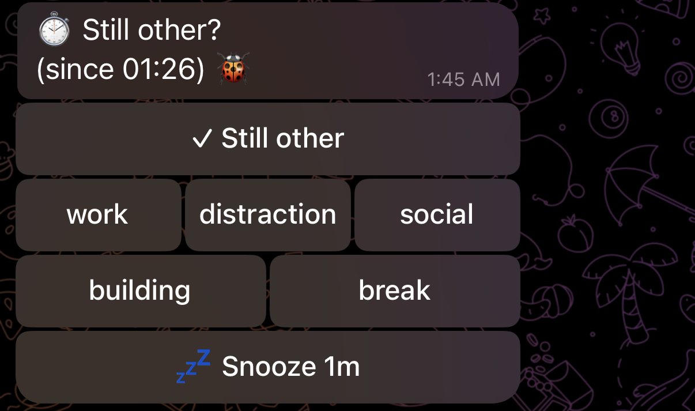
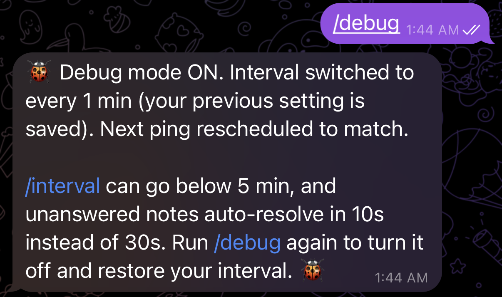
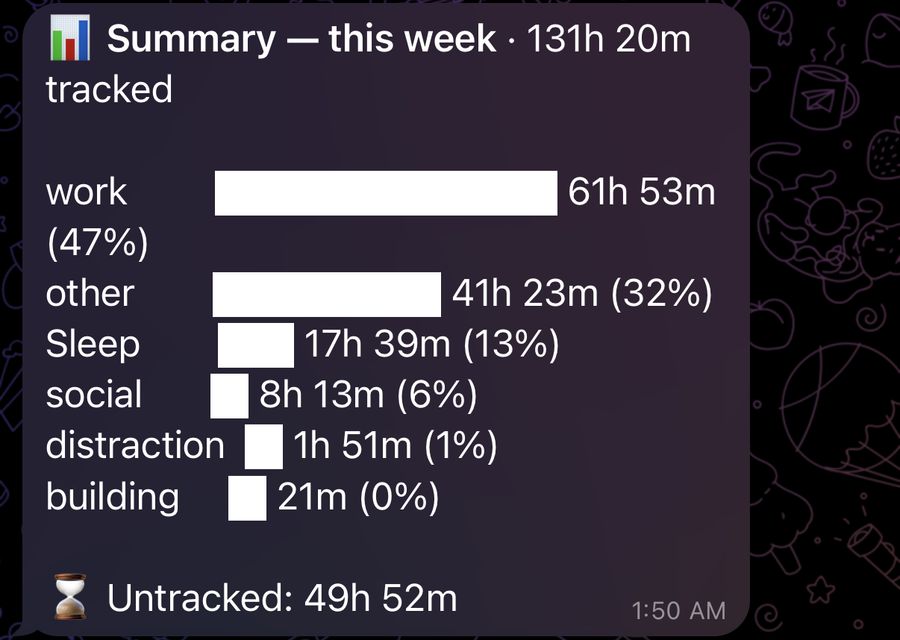
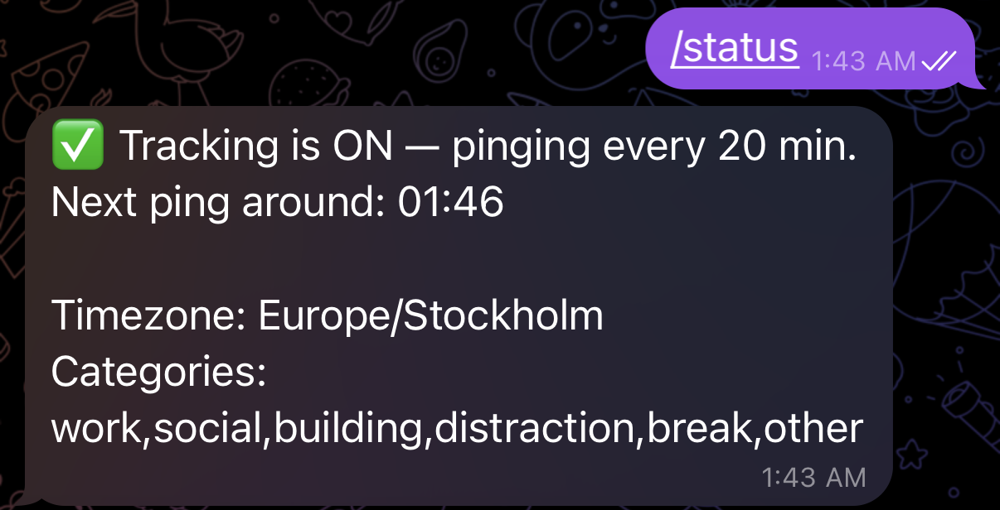
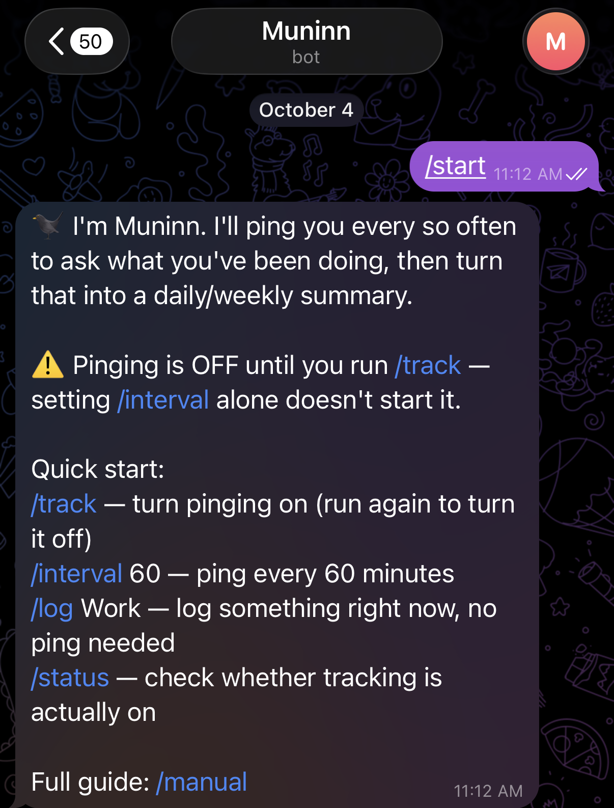

In Norse mythology, Odin keeps two ravens, Huginn and Muninn: *thought* and *memory*. Every morning they fly out over the world, and every evening they come back and tell him what they saw.

**Muninn** is my version, scaled down to one person's day. Every so often it sends me a message on Telegram asking what I've been doing. I tap an answer, and it remembers so I don't have to.

- **What:** a Telegram bot that pings me on a schedule, asks what I was doing, and builds up a picture of where my time goes.
- **Why:** I wanted a clear picture of where my time goes, not where I think it goes.
- **How:** one tap per ping. Durations come from the gaps between my answers, so I never start or stop a timer.

## The tracker comes to you

Most time trackers die the same death. Logging is a chore: you have to remember to open the app, start a timer, stop it, and then piece together the afternoon you forgot to record. The tracker depends on the exact discipline it was supposed to help you build.

So I flipped it around. Muninn comes to me. A message arrives, I answer with one tap, and it does the arithmetic.

The bigger hope is simple to say and hard to do: to see how I spend my time clearly enough to spend it better, and live a little more fully because of it. Time is the thing at the centre. Sleep, money and time with the people I love might come later.

## How it works

1. Every so often (a fixed interval, or a random one within a range like 30 to 90 minutes) a message arrives: *what were you doing?*
2. I tap **✓ Still building** (or whatever I was last doing) to carry on, or pick a category: **Work, Building, Social, Break, Distraction** or **Other**. The tap is saved right away. Anything I type in the next 30 seconds becomes the note, and **Undo** and **Change** stay on the message until then, so a wrong tap is one tap to fix.
3. The answer covers the time since my last one, so a duration is the time between two answers, not a count of pings.
4. `/today` and `/week` reply with a small text bar chart and a one-line insight: the top category, and how much of the time went to distraction.

A few more commands handle the edges of a day: `/log` to record something right now, `/sleep` and `/wakeup`, `/undo`, `/status`, `/timezone` (or just share your location), and a snooze button that pushes the ping back half an hour.

{.loop}

### Work is not Building

I started with ten generic categories and cut them down to six. The change that mattered most was splitting **Work**, time I give to someone else (the PhD), from **Building**, time I give to myself (projects like this one). Both look like sitting at a laptop. They are not the same thing, and once they were separate, the summaries started saying something true about my week.

## How it got here

- **Late August.** The first version was a single-page browser app with a navy-and-amber logbook look.
- **Soon after.** I moved it to Telegram: push notifications for free, nothing to install, and replying is as easy as texting. The browser app was dropped.
- **September.** It ran on my laptop until I noticed that closing the lid killed the pings. It moved to a small cloud server (about $7 a month), running as a service that restarts itself after crashes and reboots.
- **September to October.** A long run of bugs that all looked the same from the outside...the pings stopped.
- **Early October.** A friend started using it, and their confusion reshaped the onboarding.
- **October.** Better sleep handling, a debug mode, a tidier chat, and an "away mode" for long silences.

Now I use it every day, one friend tests it, and it is still very much a prototype.

## Every bug was "the pings stopped"

A bot that pings you is only as good as its heartbeat. Most of what I learned building Muninn came from that heartbeat quietly stopping.

**The next ping waited for my answer.** The bot scheduled the next ping only after I replied. Ignore one ping and it never sent another; tracking just died. Now each ping schedules the next one the moment it fires. *Don't make the system's heartbeat depend on the user doing something.*

**Pings stopped for hours at a time.** Sending a message occasionally failed for a moment, and that failure skipped the line that scheduled the next ping. It came back only when an unrelated restart happened to revive it. A `try/finally` now makes sure rescheduling always runs. *The worst bugs are the silent ones.*

**Restarts wiped the schedule.** Scheduled jobs lived only in memory, so every deploy dropped them. The next ping time is now saved to the database and reloaded on startup.

**The laptop lid.** A tracker that sleeps when your laptop sleeps is not a tracker. That is the whole reason it lives on a server, and why free hosting tiers that put idle apps to sleep were never an option: they would have recreated the same problem.

**The default that never changed.** I changed the default categories in code, but new users kept getting the old ones. The database had stored the default when the table was first created. *Defaults belong in code, not in the schema.*

**Sleep logged as zero minutes.** `/sleep` used to log an entry straight away, so every night came out roughly zero minutes long. Now it just marks bedtime, and my first answer after waking closes the entry, so the night gets its full length. A night longer than 12 hours isn't believable; it means I missed the wake ping, and the extra time counts as untracked.

**Handling larger gaps.** If I didn't answer for half a day, the bot used to hand all of it to whatever I tapped next. Now each answer covers a capped amount of time, and the rest shows up separately as **Untracked**, outside the category totals. After three missed pings in a row it goes into away mode and nudges less and less often, every 3 hours, then 12, then 24, before pausing. I'd rather have a hole in the data than a lie in it.

**Chat clutter.** Unanswered pings used to pile up as new messages. Now the bot edits the same message in place. That exposed a funny one: Telegram returns an error if you "edit" a message without changing anything, and the bot read that as a failure and sent duplicates.

**Python 3.14 broke the Telegram library** on a fresh server. The fix was to upgrade the library, not downgrade Python.

**Testing something that pings hourly is slow.** `/debug` switches to one-minute pings and short timeouts, tags every message with 🐞, and restores my usual settings when I turn it off.

## What it taught me about my time

Mostly, that I dilly-dally. A lot of my day drifts away in small, forgettable pieces, none of which I would ever have written down myself. Seen together at the end of a week, they add up to more than I'd like to admit.

The other lesson is the hopeful one. When I really focus, I can get a lot done in very small blocks of time. The blocks don't need to be long. They just need my full attention.

## What a second user taught me

My friend set an interval but never switched tracking on, then waited for pings that were never going to come. That became `/status`.

They typed their timezone in lowercase, the way anyone would, and the bot rejected it. Now it doesn't care about capitals.

Small things like that are where people give up on something without ever saying why. And I couldn't see any of them, because I already knew how everything worked. You can't see your own onboarding.

## What's next

- Maybe your phone's Screen Time as an extra signal.
- Reusing the scheduling and storage underneath for other "ping me and remember" ideas.
- Maybe, one day, something other people could rely on. That would need proper protection for each person's data first.

## Stack

Python, `python-telegram-bot` and SQLite: about 1,500 lines in a single file, running as a systemd service on one small Hetzner server, with a one-command deploy.

## Updates

**Oct 17, 2026.** Started this page.
